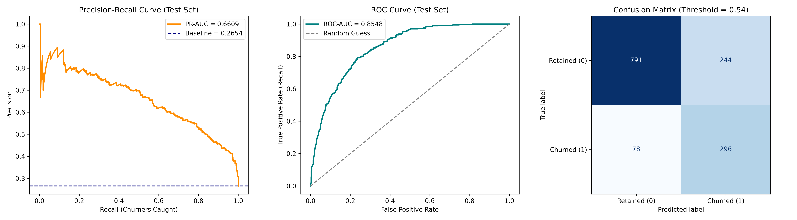
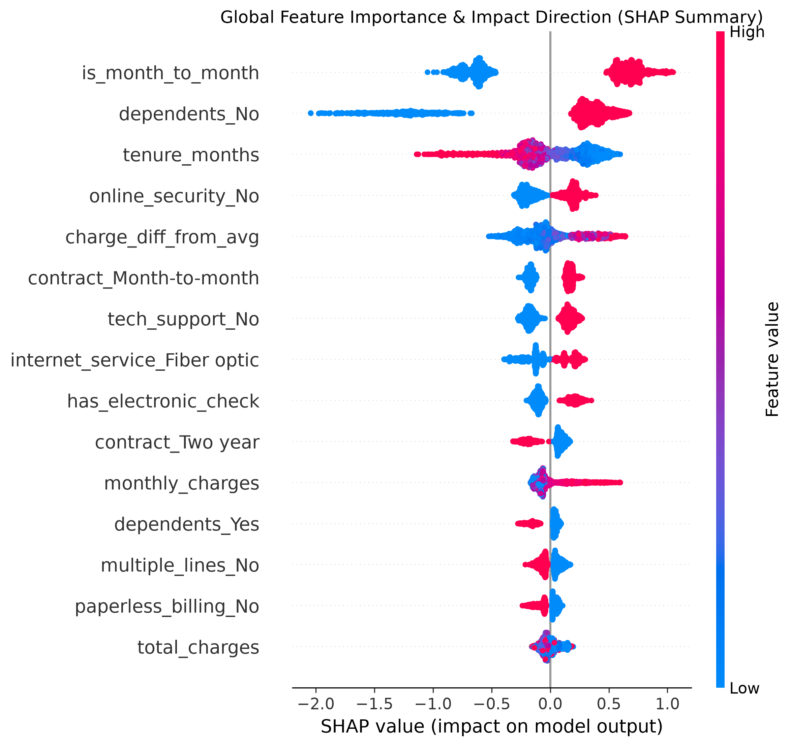

# RetentionAI — Telco Customer Churn Prediction & Explainability System

[](https://python.org)
[](https://tiangolo.com)
[](https://streamlit.io)
[](https://readthedocs.io)
[](https://readthedocs.io)

An end-to-end, leakage-free Machine Learning system built to predict telecom customer churn, surface individual risk drivers using **SHAP (SHapley Additive exPlanations)**, and serve real-time and batch predictions through a **decoupled FastAPI + Streamlit microservice architecture**.

## 1. Business Problem & ML Framing

Acquiring a new telecom subscriber costs **5x more** than retaining an existing one. With a baseline churn rate of **26.54%** in the IBM Telco dataset (7,043 customers), relying on raw accuracy is misleading.

* **Objective:** Predict customer churn probabilities prior to contract cancellation so retention teams can deploy targeted interventions.
* **Primary Optimization Metric:** **PR-AUC (Precision-Recall AUC)** to evaluate minority-class ranking under class imbalance, paired with **ROC-AUC** and business-tuned **Recall**.
* **Decision Threshold Optimization:** Shifted from the default `0.50` cutoff to **`0.535`** via Precision-Recall curve analysis to maximize F1-score while capturing **79.1% of all actual churners**.

## 2. System Architecture & Repository Structure

The application enforces strict separation of concerns: **Streamlit** acts purely as a lightweight UI client communicating via HTTP REST calls to the **FastAPI** inference engine, preventing training-serving skew and enabling independent horizontal scaling.

```text
telco-churn-prediction/
├── app/
│   ├── api.py                 # FastAPI REST microservice (/health, /predict, /explain, /predict_batch)
│   └── streamlit_app.py       # Interactive Retention Dashboard + Batch CSV/Excel Scoring UI
├── data/
│   ├── raw/                   # Original Kaggle IBM Telco XLSX dataset
│   └── processed/             # Leakage-free stratified train/test splits (.parquet)
├── models/
│   ├── churn_pipeline.joblib  # Serialized end-to-end Scikit-Learn + LightGBM pipeline
│   ├── test_evaluation_curves.png
│   └── shap_summary_plot.png
├── notebooks/
│   └── 01_eda_and_cleaning.ipynb
├── src/
│   ├── config.py              # Centralized paths, random seeds & constants
│   ├── data_prep.py           # snake_case schema standardization & stratified Parquet export
│   ├── features.py            # Custom Scikit-Learn Transformer & ColumnTransformer
│   ├── train.py               # 5-Fold Stratified CV benchmark & Optuna hyperparameter tuning
│   └── evaluate.py            # One-time held-out test evaluation & SHAP plot generation
├── .streamlit/config.toml     # Custom enterprise UI theme
├── requirements.txt
└── README.md
```

## 3. Engineering Highlights & Leakage Prevention

1. **Data Hygiene & Leakage Audit:**
   * Standardized messy Excel column headers into clean `snake_case`.
   * Detected and purged post-churn target-leakage columns (`churn_reason`, `churn_score`, `churn_label`) alongside zero-variance fields (`country`, `state`, `count`).
   * Resolved 11 hidden blank strings in `total_charges` caused by brand-new subscribers (`tenure_months == 0`) using domain logic (`0.0`).
   * Executed an **80/20 Stratified Split** saved in columnar **Parquet** format *before* fitting any stateful transformations.
2. **Custom Domain Feature Engineering (`TelcoFeatureEngineer`):**
   * `avg_monthly_spend` and `charge_diff_from_avg`: Captures sudden monthly bill increases ("bill shock").
   * `total_addon_services`: Quantifies ecosystem lock-in across 6 security/streaming add-ons.
   * `is_month_to_month` and `has_electronic_check`: Explicit behavioral risk flags derived from EDA.
   * Out-of-fold safe **Frequency Encoding** for high-cardinality `city` names (`1,100+` unique cities).

## 4. Model Benchmarking & Unbiased Test Evaluation

### 5-Fold Stratified Cross-Validation Benchmark (Training Set)

| Model | CV PR-AUC (Mean ± Std) | CV ROC-AUC | CV Recall | Notes |
| :--- | :---: | :---: | :---: | :--- |
| **LightGBM (Optuna Tuned)** | **0.6885** | **0.8615** | **0.8010** | Best overall; depth-constrained (`max_depth=4`) to prevent overfitting |
| Logistic Regression | 0.6867 ± 0.0136 | 0.8607 | 0.8040 | Strong linear baseline benefiting from engineered features |
| XGBoost (Default) | 0.6641 ± 0.0190 | 0.8542 | 0.7284 | Higher variance prior to regularization |
| LightGBM (Default) | 0.6611 ± 0.0175 | 0.8533 | 0.7137 | Overfit on 5.6k rows before Optuna tuning |
| Random Forest | 0.6513 ± 0.0204 | 0.8525 | 0.6769 | Lower recall on minority class |
| Dummy Baseline | 0.2654 ± 0.0001 | 0.5000 | 0.0000 | Majority-class floor |

### Final One-Time Evaluation on Held-Out Test Set (`n = 1,409`)

* **Test PR-AUC:** **`0.6609`** *(2.5x lift over 0.2654 baseline)*
* **Test ROC-AUC:** **`0.8548`**
* **Recall at Optimal Threshold (`0.535`):** **`79.14%`** *(296 of 374 actual churners identified)*
* **Precision at Optimal Threshold (`0.535`):** **`54.81%`**



## 5. Explainability & Actionable Business Recommendations

Using **SHAP TreeExplainer**, global feature attributions validated our engineered features—with **`is_month_to_month`** ranking as the top churn driver and **`charge_diff_from_avg`** ranking in the Top 5.



### Recommended Retention Playbooks

1. **Contract Migration Offers:** Target `Month-to-month` subscribers (`is_month_to_month == 1`) with a 15% discount to convert into 1-year agreements.
2. **Early-Tenure Security Bundles:** Provide new subscribers (`tenure_months < 12`) a free 3-month trial of `Online Security` and `Tech Support` to increase service stickiness.
3. **Auto-Pay Incentives:** Offer $5 monthly bill credits to `Electronic check` payers who switch to automatic bank or card billing.

## 6. Quickstart & Local Deployment

### Step A: Environment Setup

```bash
git clone https://github.com
cd telco-customer-churn-prediction

python -m venv .venv
source .venv/bin/activate  # On Windows: .venv\Scripts\activate
pip install -r requirements.txt
```

### Step B: Run the ML Pipeline

```bash
# 1. Clean raw Excel & export stratified Parquet splits
python -m src.data_prep

# 2. Run 5-Fold CV benchmark, Optuna tuning & export pipeline
python -m src.train

# 3. Execute one-time test evaluation & generate SHAP plots
python -m src.evaluate
```

### Step C: Launch Decoupled Microservices (2 Terminals)

```bash
# Terminal 1: Start FastAPI Inference & SHAP Backend (Swagger UI at http://127.0.0)
uvicorn app.api:app --reload --port 8000

# Terminal 2: Start Interactive Streamlit Retention Dashboard
streamlit run app/streamlit_app.py
```
